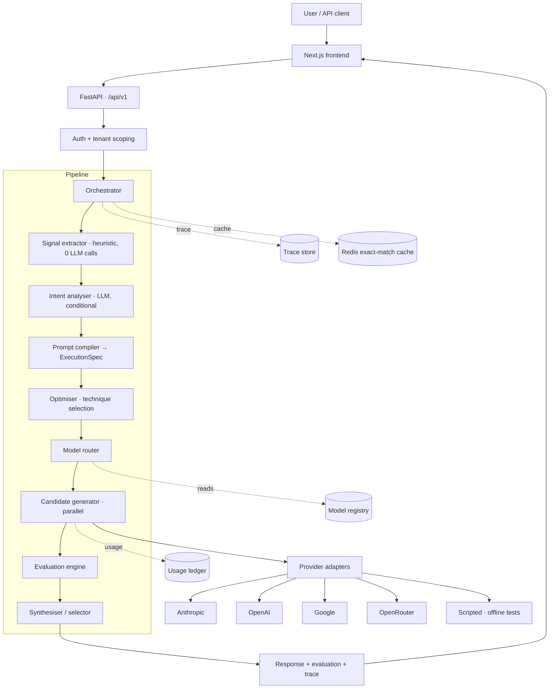
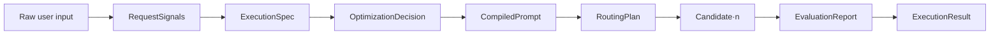
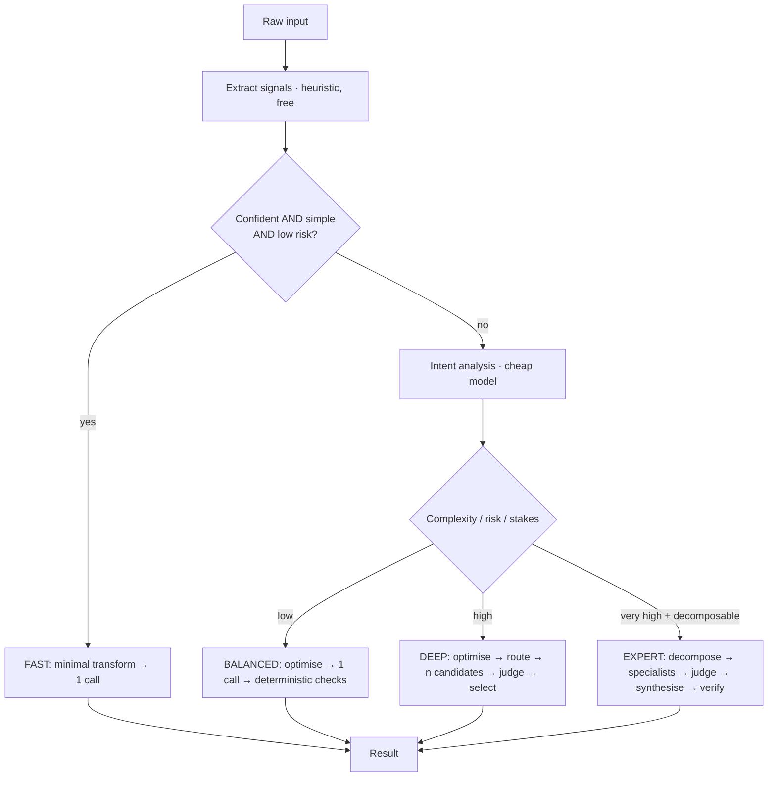
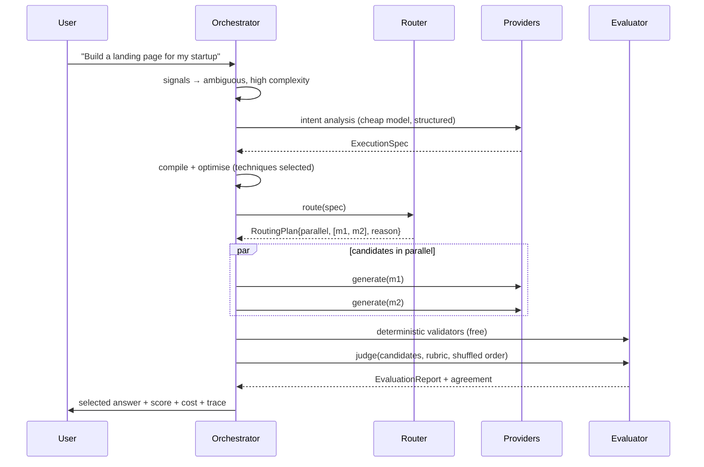

# Architecture

## 1. System overview



## 2. The central abstraction: `ExecutionSpec`

Every stage reads and writes one typed IR (ADR-002). This is what makes stages independently testable and
skippable.



`ExecutionSpec` carries: task type, goal, domain, entities, constraints, audience, tone, format, output schema,
complexity, ambiguity, risk level, freshness need, tool need, modality, reasoning depth — plus the *provenance*
of each field (heuristic vs LLM vs user-supplied), which is what powers the "why this prompt?" view.

## 3. Adaptive orchestration

The policy that decides how much to spend. This is the product's core differentiator.



The `C` branch is the whole point: a trivial request costs exactly one model call, because the decision to
skip is itself free (ADR-003).

**Escalation.** Modes are not one-shot. A BALANCED run whose deterministic validators fail escalates to a
bounded repair-retry; a low judge score can escalate to DEEP. Escalation is bounded by attempt count *and* by
remaining budget, so it can never loop.

## 4. Backend layout

```
backend/app/
  core/          config, security, errors, logging, ids, clock
  db/            SQLAlchemy models, session, Alembic migrations
  providers/     base protocol + anthropic/openai/google/openrouter/scripted adapters
  registry/      model registry service + models.yaml catalogue
  pipeline/      signals, intent, taxonomy, compiler, optimizer, router,
                 orchestrator, generation, synthesis
  evaluation/    deterministic, rubric, judge, aggregate
  security/      spotlight (datamarking), redaction, key encryption, injection heuristics
  metering/      cost estimation, usage ledger, budget enforcement
  observability/ trace tree, span recording, exporter interface
  api/v1/        routers: optimize, execute, compare, evaluate, route, models,
                 prompts, executions, feedback, auth, analytics
```

**Dependency rule:** `pipeline` and `evaluation` depend on `providers` only through the protocol in
`providers/base.py`. Nothing in `pipeline` imports a concrete provider. This is what keeps "add a provider
without touching business logic" true rather than aspirational.

## 5. Provider abstraction

```python
class Provider(Protocol):
    name: str
    async def complete(self, req: ModelRequest) -> ModelResponse: ...
    async def stream(self, req: ModelRequest) -> AsyncIterator[Chunk]: ...
    def supports(self, cap: Capability) -> bool: ...
```

Adapters own: auth, request/response translation, **JSON-Schema dialect translation** (ADR-010), error
normalisation into a shared taxonomy (`RateLimited`, `Timeout`, `InvalidRequest`, `ProviderUnavailable`,
`ContentFiltered`), and usage extraction.

The core never sees a provider-specific error or schema quirk. The `scripted` provider is a deterministic
offline adapter used by tests and by the benchmark harness so the entire pipeline is exercisable with **no API
keys and no network** — this is what makes CI meaningful.

## 6. Data flow for a DEEP request



Parallel fan-out is `asyncio.gather`, not sequential (rule 20). Latency of N candidates ≈ latency of the
slowest, not the sum.

## 7. Multi-tenancy

```
Organization → Workspace → Project → Prompts / Executions / Evaluations
                        ↘ Members (role)
```

Isolation is enforced in three layers, deliberately redundant:
1. **Request scope** — the authenticated principal resolves to an `org_id`; a `TenantScope` object is threaded
   through the request.
2. **Query layer** — a repository base class requires an explicit scope argument; queries without one fail at
   import-time review and in tests.
3. **Database** — every tenant-owned table carries `org_id` with a composite index; destructive operations are
   scoped.

Row-Level Security is a Phase 2 hardening step (documented in `SECURITY.md`) — the column + repository
discipline is the MVP guarantee, and tenant-isolation tests assert cross-org access returns 404, not 403
(not leaking existence).

## 8. Failure handling

| Failure | Handling |
|---|---|
| Provider timeout | Bounded retry with jittered backoff, then fallback model if the plan allows |
| Rate limited | Respect `Retry-After`; fall back rather than hammer |
| Malformed/invalid JSON | Local schema validation → one bounded repair attempt → deterministic failure |
| Provider outage | Circuit breaker per provider; router excludes unavailable providers |
| Evaluator failure | Result returns with `evaluation_status: unavailable` — never blocks the answer |
| Budget exceeded | Pre-flight refusal or downgrade (ADR-011) |

**Every retry path is bounded by attempts and by budget.** Fallbacks respect capability requirements — we never
silently fall back to a model that cannot do structured output for a request that requires it.

## 9. What is deliberately absent

- No background queue (ADR-012).
- No vector DB / RAG in MVP — file support is Phase 2.
- No semantic cache serving traffic (ADR-005).
- No microservices. One API process, one frontend, Postgres, Redis. It runs on a laptop with
  `docker compose up`, which RESEARCH 8.1 identifies as a genuine acquisition lever for the developer segment.
