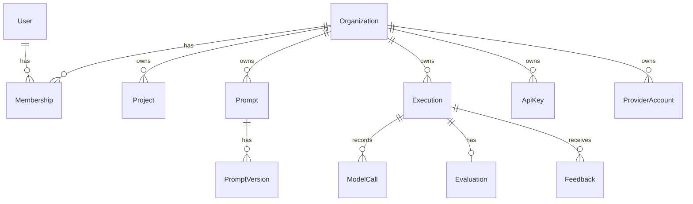

# Database

PostgreSQL via SQLAlchemy 2.0 async + Alembic. Schema source of truth: `backend/app/db/models.py`.
Migrations: `backend/migrations/versions/`.

## Entity overview



## Tables and their purpose

| Table | Purpose |
|---|---|
| `organizations` | Tenant root. Carries the monthly budget and current spend (denormalised — read on every pre-flight budget check), retention policy, and the `store_raw_prompts` privacy flag. |
| `users` | Login identity. Carries `preferences` (JSON) and `memory_enabled` for the explicit, user-controlled preference memory (rule 24). |
| `memberships` | User ↔ org join with a `role`. A user can belong to multiple orgs. |
| `projects` | Durable context reused across requests (rule 25). |
| `api_keys` | Programmatic access. Only `key_hash` is stored; `key_prefix` is for display/lookup narrowing. |
| `provider_accounts` | Tenant bring-your-own provider keys, `encrypted_key` via Fernet, never plaintext. |
| `prompts` / `prompt_versions` | Versioned prompt library (rule 15). Versions are immutable; `prompts.active_version_id` is the only mutable pointer, so rollback never edits history. |
| `executions` | One row per orchestrator run. Holds the spec/plan/trace snapshots, cost, and — **only if the org opted in** — the raw input/output. |
| `model_calls` | One row per provider call, for cost attribution and debugging. Content-bearing metadata, subject to retention deletion. |
| `usage_records` | Append-only billing ledger (ADR-011). Deliberately separate from `model_calls`: it holds no user content, so it survives retention deletion of the execution it came from. |
| `evaluations` | One row per execution's evaluation result, including judge bias mitigations actually applied (RESEARCH 5.1). |
| `feedback` | Human signal. Never auto-applied to production behaviour (rule 23). |
| `audit_logs` | Security-relevant events (login, signup, feedback). Append-only; not subject to retention deletion. |

**Deliberately absent from MVP** (rule 53 test applied, see `ROADMAP.md`): `datasets`, `dataset_items`,
`experiments`, `experiment_runs`, `files`, `subscriptions`. Each belongs to a Phase 2/3 feature; an empty
table is not architecture.

## Indexing

Every tenant-owned table has `org_id` indexed, and the hot query paths get composite indexes:

- `executions(org_id, created_at)` — recent-executions list
- `executions(org_id, task_type, created_at)` — analytics by task
- `usage_records(org_id, recorded_at)` — billing rollups
- `prompt_versions(prompt_id, version)` unique — version ordering and rollback lookup

## Migrations

```bash
cd backend
alembic revision --autogenerate -m "description"   # after changing app/db/models.py
alembic upgrade head                                # apply
alembic downgrade -1                                # roll back one step
```

`migrations/env.py` reads `DATABASE_URL` from application settings (env vars), not from a value committed
to `alembic.ini` — the same migration set runs unmodified in dev, CI, and production.

**Never** run `Base.metadata.create_all()` against a production database — it was used only to bootstrap
the very first Alembic revision from the ORM models, and the app does not call it at runtime.

## Privacy-by-design in the schema

- `executions.raw_input` / `.output` are nullable and only populated when `organizations.store_raw_prompts`
  is true — enforced in `app/services/persistence.py`, not just documented.
- `executions.input_redacted` records which state applied, so a UI can say "content not retained" rather
  than showing an empty field ambiguously.
- Retention deletion (a scheduled job, not yet implemented — see `ROADMAP.md`) will delete `executions`
  and `model_calls` past `organizations.retention_days`, while `usage_records` and `audit_logs` are
  designed to survive that deletion by construction (no user content in either table).
